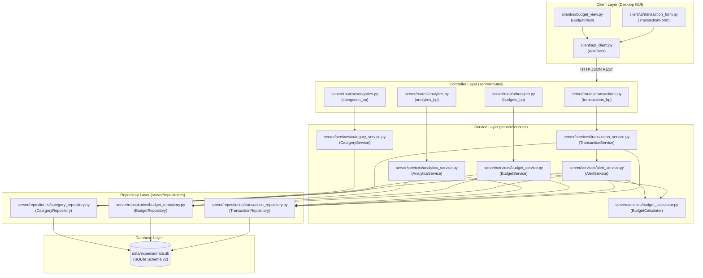
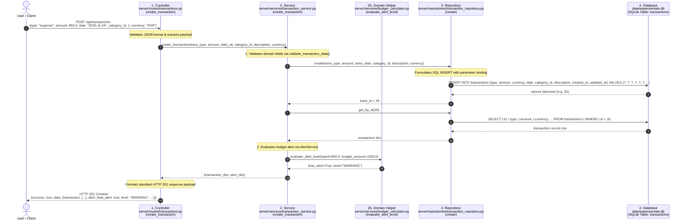

# Architecture After Part B Refactoring

## 1. High-Level Architectural Diagram (After)

In the refactored architecture, all layer bypasses have been removed. Every request flows downward strictly through:
$$\text{Controllers} \longrightarrow \text{Services} \longrightarrow \text{Repositories} \longrightarrow \text{Database}$$

Threshold calculations are centralized in `BudgetCalculator`, and category management is handled by `CategoryService`.

---

## 2. Trace of Add Transaction Request (Live Demo Reference)

For demonstration, here is the exact trace of an Add Transaction request flowing downward through all four architectural tiers:

