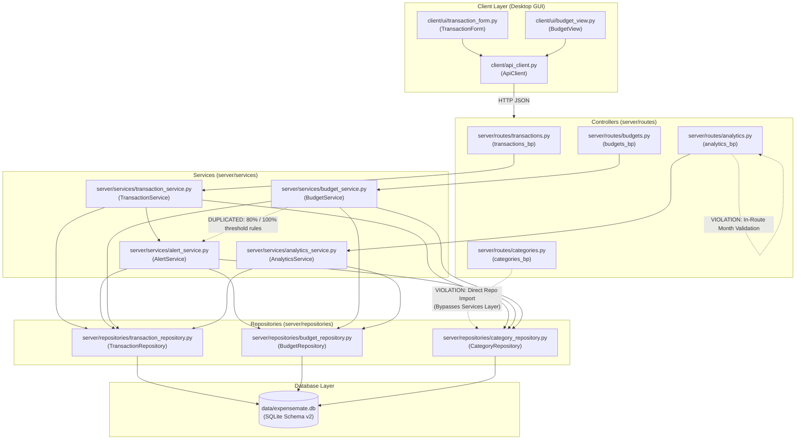
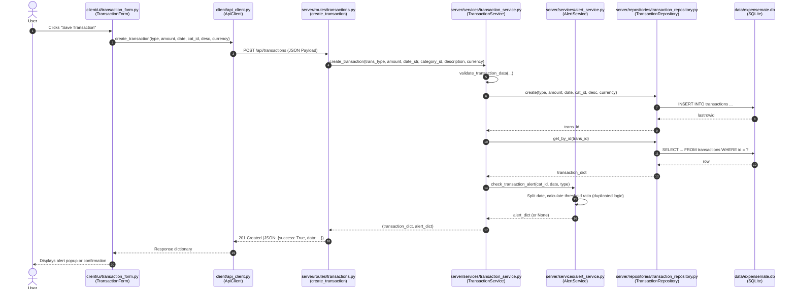

# Architecture Before Part B Refactoring

## 1. High-Level Architectural Diagram (Before)

Before Part B refactoring, ExpenseMate exhibited architectural inconsistencies: direct repository imports inside certain controllers (bypassing the service layer), duplicated business threshold calculations across multiple services, and business input validation logic embedded inside HTTP route handlers.

---

## 2. Trace of Add Transaction Request (Before Refactoring)

