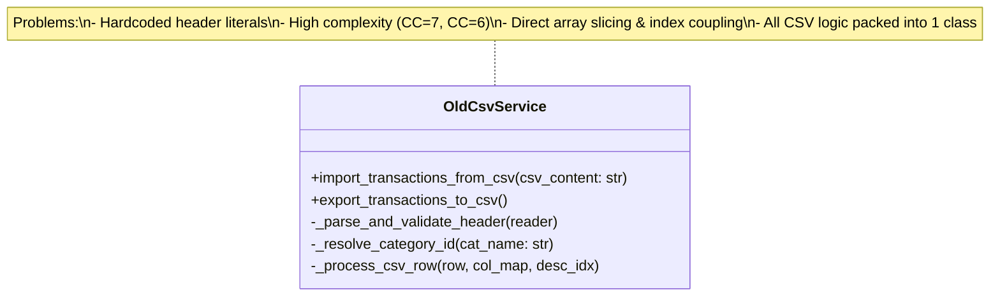
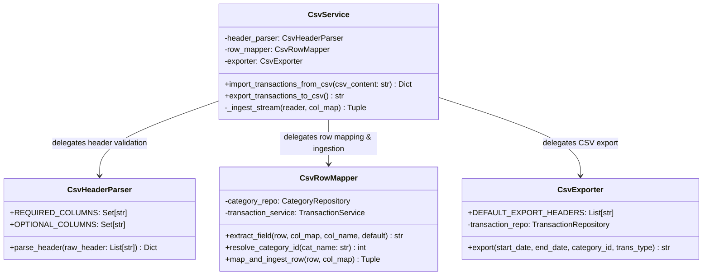
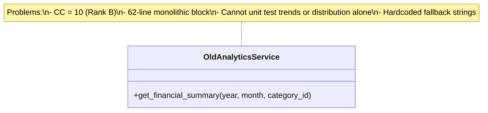
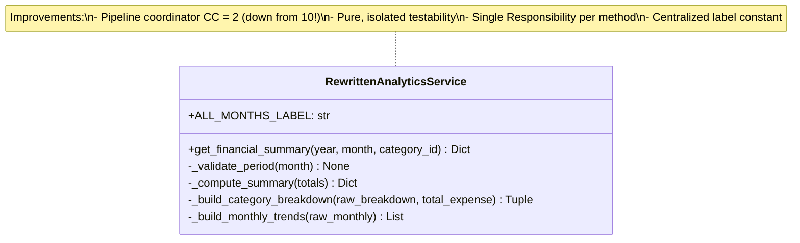

# Class Rewrites Architecture Diagrams (Part C)

## 1. `CsvService` Modular Decomposition & Rewrite

### Before Rewrite
The old `CsvService` handled low-level index resolution, raw array indexing, side-effectful category creation, and CSV export in a single coupled class.

### After Rewrite (Decomposed Architecture)
The rewritten architecture separates concerns into 4 focused classes: `CsvHeaderParser`, `CsvRowMapper`, `CsvExporter`, and a thin facade `CsvService` that coordinates them.

---

## 2. `AnalyticsService` Rewrite Comparison

### Before Rewrite
The old `AnalyticsService` ran the entire financial calculation, chart distribution synthesis, and calendar trend compilation in a single monolithic 62-line procedure (`CC = 10, Rank B`).

### After Rewrite
The rewritten `AnalyticsService` decomposes the pipeline into single-responsibility methods, reducing `get_financial_summary` to `CC = 2`.

