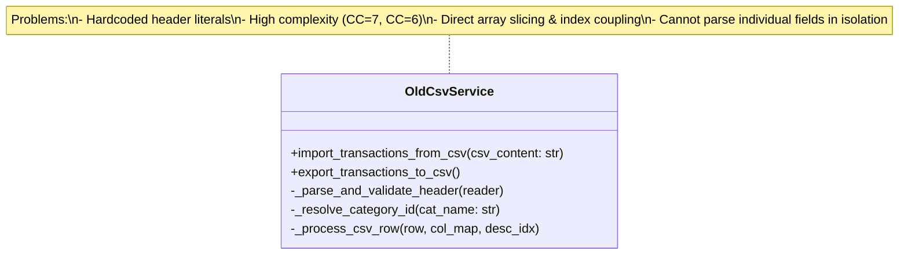
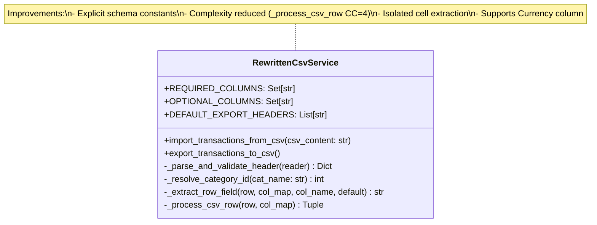
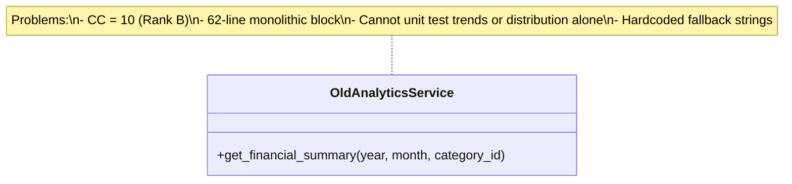
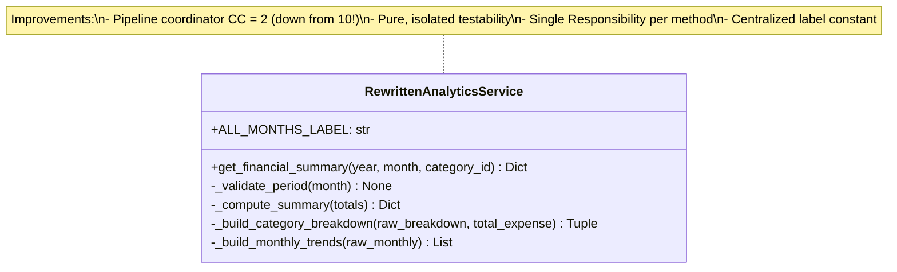

# Class Rewrites Architecture Diagrams (Part C)

## 1. `CsvService` Rewrite Comparison

### Before Rewrite
The old `CsvService` handled low-level index resolution, raw array indexing, and side-effectful category creation in one coupled procedure.

### After Rewrite
The rewritten `CsvService` encapsulates schema constants and delegates cell value extraction to `_extract_row_field`, isolating validation and entity mapping.

---

## 2. `AnalyticsService` Rewrite Comparison

### Before Rewrite
The old `AnalyticsService` ran the entire financial calculation, chart distribution synthesis, and calendar trend compilation in a single monolithic 62-line procedure (`CC = 10, Rank B`).

### After Rewrite
The rewritten `AnalyticsService` decomposes the pipeline into single-responsibility methods, reducing `get_financial_summary` to `CC = 2`.

